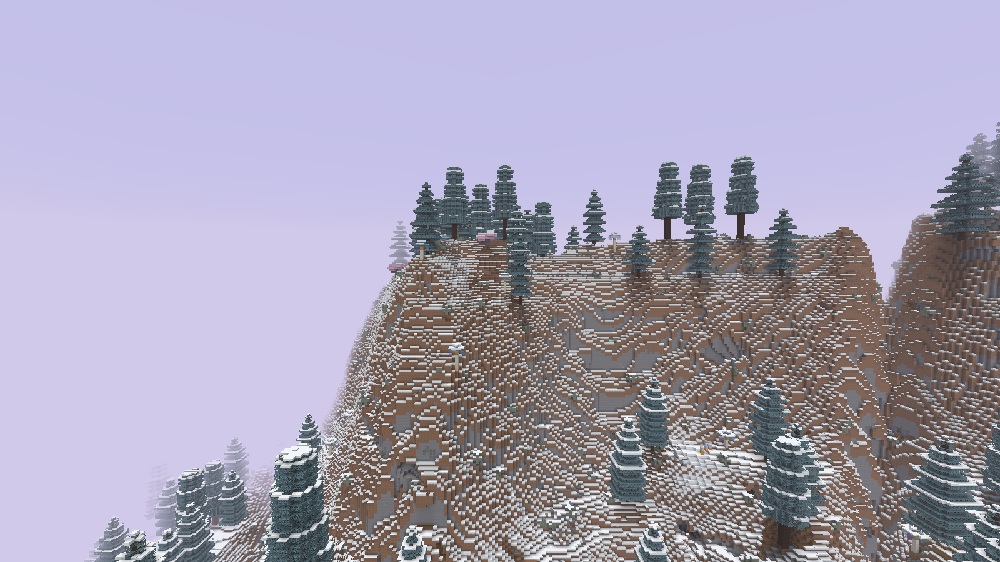
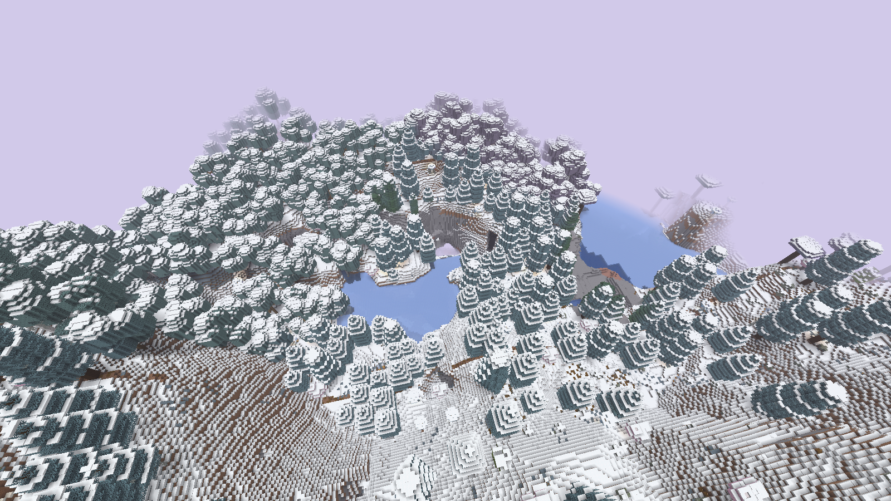
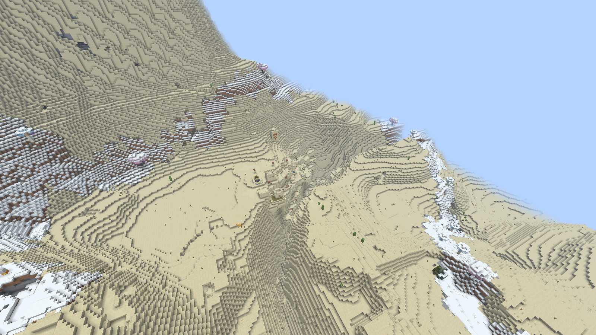

# MidgardWinterWorld 0.6.0 — новый сказочный рельеф

Один JAR для **Paper/Purpur 1.21.11 / Java 21**. Теперь меняются сами формы обычного мира:высокие гряды, ступенчатые плато, глубокие долины и провалы. Зимнее оформление остаётся только в подходящих биомах; пустыни/саванны/джунгли не превращаются в зимние. Nether и End не меняются.

**[Скачать JAR0.6.0](https://raw.githubusercontent.com/lutiytoper-collab/WinterGeneration/main/dist/MidgardWinterWorld-0.6.0.jar)** · [Реальные F2-кадры](reports/screenshots-terrain06/README.md) · [Все файлы](dist/)







## Установка и режим

Нужен **новый обычный NORMAL мир**. Замените JAR на остановленном тестовом сервере, оставив одну копию плагина. Внешний datapack ZIP не требуется. Для позднего декора своего имени мира добавьте его в allowed-worlds.

```yaml
fantasy-pack-enabled: true
fantasy-terrain-enabled: true
```

Рельеф включён по умолчанию, даже если нового ключа нет в старом config.yml. Для прежнего рельефа поставьте fantasy-terrain-enabled:false до первого создания мира. Нужен полный restart. Старые чанки не изменяются; переключение профиля в существующем мире может дать резкие стыки. Native registry применяется ко всем обычным Overworld worlds с этими settings, allowed-worlds ограничивает только поздний декор.

В логе FANTASY_TERRAIN_ENABLED true/false показывает профиль. Глобальный enabled:false отключает весь pack. [Установка](docs/FANTASY_INSTALL.md) · [Рельеф и ограничения](docs/TERRAIN.md) · [Комплект ZIP](dist/Midgard-Fantasy-0.6.0.zip). WinterProbe.jar только для QA.

## Пещеры, руды и структуры

Рельеф создаётся native генератором до размещения структур. В настройках меняется только final density; исходные cave/ore/structure definitions, биомные входы, водоносные inputs, surface rules и sea level сохранены. Новая depth-поправка равна нулю до Y48. Деревни используют штатные heightmaps/пулы и адаптацию к земле, готовые постройки после генерации не переносятся.

В сверенном участке совпали классы полостей/воды/лавы на 1 572 864 одинаковых координатах Y−64..31. **Поблочное совпадение не обещается:**руды, породы и пещерные растения местами разместились иначе. Два строгих raw material/ore FAIL сохранены как диагностика, не переименованы в PASS.

На 64 ROI рельеф изменился в среднем на 65.54 блока по высоте,16 363 из 16 384 колонок сдвинулись минимум на 8. В широкой sparse map4356 одинаковых XZ средняя разница 35.34 блока; найдены уровни грунта Y9..255. Это реальные выборки одного seed, не гарантии любого мира.

Проверены равнинная и пустынная деревни:18 дверей с полом,1715 sampled foundations, max air gap1/5. Пустыня сохранила температуру 1.95. Native stronghold/mineshaft/ancient_city/trial_chambers и три cave biome найдены. Все дороги/дома/seed не проверены; на крутом рельефе возможны резкие перепады улиц.

## Для анархии

Постройки обычные разрушаемые блоки. Плагин не создаёт приватов и не запрещает ломание/строительство/взрывы. Текущий non-OP survival-клиент реально сломал руину, поставил блок и разрушил его TNT.

Новый декор не содержит драгоценных блоков, аметиста, редких ламп, железных фонарей и синего/уплотнённого льда. Подсветка — дешёвые светильники Джека. Натуральные руды и лут ванильных структур не удаляются. Старые ценные блоки автоматически не заменяются. [Подробности](docs/ANARCHY.md).

Ивы, цветные грибы, шесть арок/святилищ/руин и прежние защитные проверки генератора сохранены. Две арки адаптируют внешние CC0-контуры, четыре композиции собственные. [Источники](THIRD_PARTY_NOTICES.md). Большие схематики, мосты и сеть дорог пока не реализованы.

## Проверки

182 Java + 32 Python PASS без skipped. Полный текущий каталог — [TEST_RESULTS.md](reports/TEST_RESULTS.md), raw JSON — test-results.json. Оба Paper WG/Luna+WE/FAWE стека прошли реальные fixtures, клиента, дроп на 5×5, Chunky и cleanup. Для высоких новых земель QA генератор Luna использовал max-y 280; конфиг чужого плагина автоматически не переписывается.

Purpur проверил global disable/restart, Paper — отдельный classic-профиль и второй seed 42 smoke/restart. Основная 64 ROI матрица использует сохранённый vanilla baseline. Текущий JAR одинаков во всех финальных QA-папках. Пять native F2 PNG проверены по SHA/CRC и совпадению с оригиналами, без обработки/ручной постройки сцен.

**TEST VERIFIED в указанном объёме, не RELEASE CANDIDATE.** Нет полного 50–100 player soak, всех seed/краёв крон/деревень, экономики и специальных Luna сценариев. [Итог](reports/FINAL_REPORT.md) · [Ограничения](reports/KNOWN_ISSUES.md) · [Производительность](reports/PERFORMANCE_REPORT.md).

## Сборка

```bash
bash scripts/bootstrap.sh
source scripts/env.sh
LUNA_JAR=/absolute/path/LunaAirDrop.jar bash scripts/check.sh full
python3 scripts/check-artifacts.py
python3 scripts/report.py
python3 scripts/package.py
```

report.py требует результаты реальных QA-прогонов. Публичный Paper API, production NMS/CraftBukkit нет. Данные vanilla pinned в vendor/, профиль в terrain/, сборщик scripts/terrain.py. Чужие/серверные JAR не распространяются. Исторические версии 0.1–0.5 сохранены. Удаление плагина не удаляет готовый рельеф; полный откат требует согласованной резервной копии.
