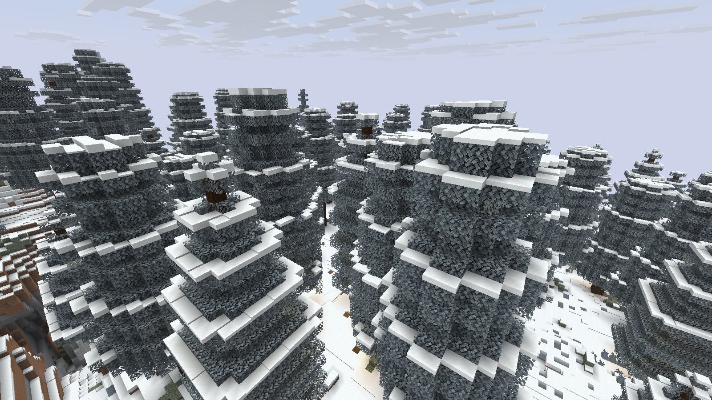
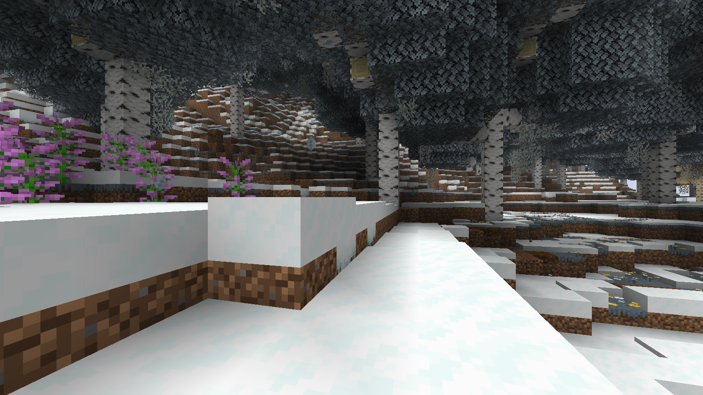

# MidgardWinterWorld0.3.0 — Storybook

Новый режим заменяет саму лесную растительность: высокие инеевые ели, широкие ветвящиеся берёзы, древние дубы, почти белая листва, свисающий иней и редкие фонари под кронами. Это отдельный native-датапак для **Minecraft 1.21.11 / Java 21**, вместе с безопасным поздним декором Paper/Purpur. [Настоящие игровые F2-кадры](reports/screenshots-storybook/README.md), [подробности режима](docs/STORYBOOK.md).





## Быстрый запуск

Готовая раскладка файлов: **[Midgard-Storybook-0.3.0.zip](https://raw.githubusercontent.com/lutiytoper-collab/WinterGeneration/main/dist/Midgard-Storybook-0.3.0.zip)**. Распакуйте её в отдельный новый тестовый сервер Paper/Purpur 1.21.11. Серверный JAR в комплект не входит.

Если ставите отдельно:

1. Положите [MidgardWinterWorld.jar](dist/MidgardWinterWorld.jar) в plugins/.
2. Скопируйте [config-storybook.yml](dist/config-storybook.yml) как **plugins/MidgardWinterWorld/config.yml**. В нём отключены дополнительные overlay-деревья: лес теперь создаёт Minecraft по новому датапаку.
3. **До первой генерации** положите [storybook-datapack.zip](dist/storybook-datapack.zip) в winter_test/datapacks/. Задайте level-name=winter_test; seed825180311 воспроизводит демонстрационный ландшафт.
4. Используйте только Storybook pack: прежний winter-datapack.zip здесь не нужен, климат уже включён. Проверьте /datapack list enabled и /winterworld status. Для другого имени мира измените allowed-worlds.

**Одна замена JAR не даст нового леса. Нужны датапак, профиль и новые чанки; для цельного результата — новый мир.** Блоки старых чанков не перегенерируются, но биомные цвета/климат датапака действуют через глобальный registry сервера и могут менять вид уже существующих биомов. Поэтому первый запуск — отдельный тестовый сервер. Полная [инструкция установки](docs/STORYBOOK_INSTALL.md).

## Что изменилось

Семь native-форм деревьев с высотой ствола до 36 блоков заменяют 12 исходных лесных placed features. Деревья могут пересекать границы чанков внутри штатного worldgen Minecraft. В новых умеренных/холодных биомах — холодная палитра неба, тумана, воды и листвы. Списки features и их порядок, рудные/carver/structure определения сохранены; содержание 12 лесных features намеренно изменено. Это уже более сильное изменение, чем прежний climate-only режим.

Тёплые и не включённые в allowlist biome JSON не переопределяются. Для 12 замен проверена полная transitive vanilla reachability: их источники ограничены разрешёнными биомами. Общие trees_water/trees_plains/trees_snowy оставлены из-за использования вне allowlist. На выбранном пограничном участке 256 ROI поверхность excluded-биомов совпала с vanilla; все возможные выходы крупных крон за биомную границу не проверены.

Плагин добавляет сугробы, тропы, снег на кронах, небольшие снежные навесы с фонарём и новый шаблон ледяных кристаллов. Кристаллы прошли unit/preflight, но в графическом прогоне успешное природное размещение не получено. Домики отключены. Старый climate-only ZIP и обычный config.yml сохранены как альтернативный режим; они не дают native Storybook леса.

## Проверки и ограничения

**149 Java +16 Python PASS; весь каталог:416 PASS /1 FAIL /11 NOT RUN.** Реальные Paper интеграции WorldGuard/Luna с WorldEdit и отдельно FAWE прошли, Purpur прошёл smoke. На двух seed совпали 7 864 241 одинаковая подземная позиция, все сравниваемые рудные позиции/состояния, структуры и block entities. Оригинальный тест с разными высотными окнами сохранил диагностический FAIL; объяснение — [TEST_RESULTS.md](reports/TEST_RESULTS.md).

Получены 6 неизменённых F2 PNG официального vanilla-клиента 1.21.11, без шейдеров, обработки изображений и ручной постройки сцены. [Архив кадров](https://raw.githubusercontent.com/lutiytoper-collab/WinterGeneration/main/dist/game-screenshots-storybook-0.3.0.zip).

Статус **TEST VERIFIED в указанном объёме, не RELEASE CANDIDATE**. Нагрузку 50–100 игроков не проверяли. Native-деревья значительно крупнее;512 записей ограничивает только поздний плагинный проход, не native-дерево. Предварительная генерация контролируемыми порциями предпочтительна. Листва постоянная, фонари добываемые; баланс выживания отдельно не проверен. [Ограничения](reports/KNOWN_ISSUES.md), [производительность](reports/PERFORMANCE_REPORT.md), [итог](reports/FINAL_REPORT.md).

## Сборка

```bash
bash scripts/bootstrap.sh
source scripts/env.sh
LUNA_JAR=/absolute/path/LunaAirDrop.jar bash scripts/check.sh full
python3 scripts/check-artifacts.py
python3 scripts/report.py
python3 scripts/package.py
```

Опубликованный официальный Paper API1.21.11, Java 21; production NMS/CraftBukkit нет. Bootstrap сохраняет proxy и CA и проверяет загрузки. Без предоставленного Luna JAR2 контрактных теста пропускаются; итоговая проверка выполнена с ним. Native-ресурсы закреплены checksum-проверенным официальным сервером; повторное извлечение: scripts/storybook.py --pin-official /path/to/mojang-inner.jar при наличии соответствующего проверенного bundle в runtime. Данные уже включены в sources.zip, скачивать их для обычной сборки не нужно.

WinterProbe.jar — только QA, в установочный комплект не включён. Для Luna см. [LUNA_INTEGRATION.md](docs/LUNA_INTEGRATION.md), для ограниченного Chunky — [CHUNKY.md](docs/CHUNKY.md). Пользовательские Luna/WG и серверные JAR не распространяются.

## Откат

Удаление плагина/датапака останавливает будущие изменения, но не удаляет готовые деревья, снег, тропы и PDC. Для полного отката восстановите согласованную резервную копию при остановленном сервере. Ретрогенерации и автоматической уборки декора нет. Прошлые артефакты: dist/previous/0.1.0 и 0.2.0; старые отчёты: reports/history/.

Все готовые сборки, архивы исходников/отчётов, скриншоты и SHA256SUMS доступны в [dist/](dist/). [Страница версии v0.3.0](https://github.com/lutiytoper-collab/WinterGeneration/releases/tag/v0.3.0) содержит описание и ссылки на файлы. Архивы сохранены прямо в Git вместе с кодом, отчётами и исходными PNG.
