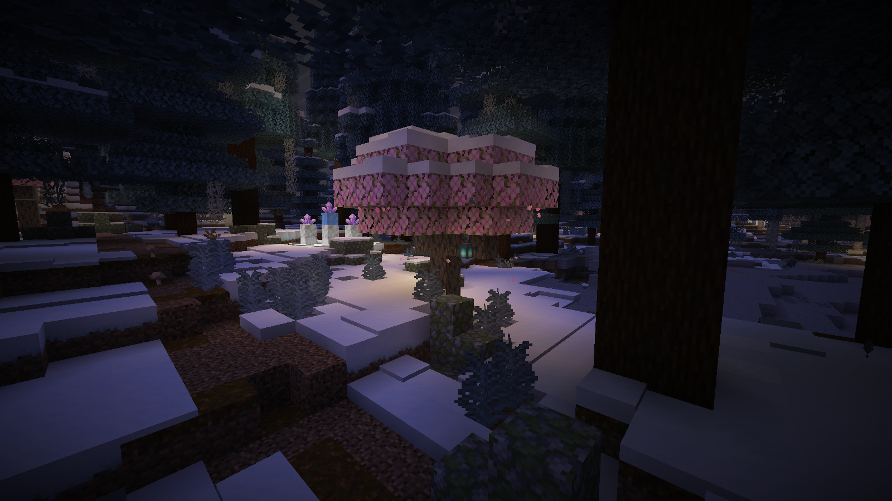
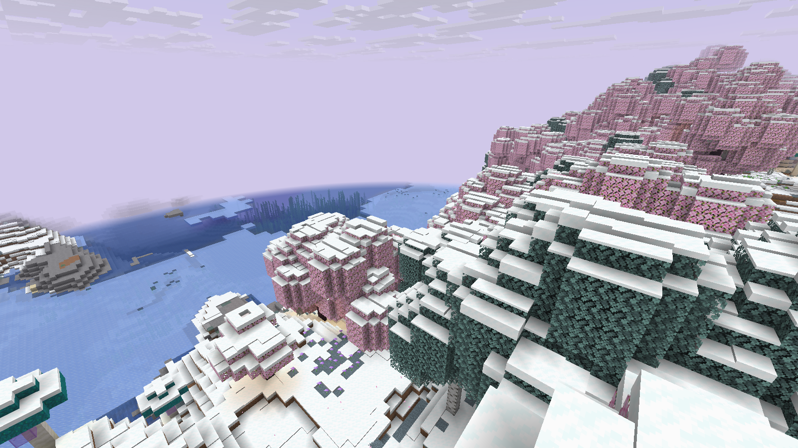

# MidgardWinterWorld 0.4.0 — Fantasy

**Один готовый JAR** для Paper/Purpur **1.21.11 / Java 21**. Встроенная native-генерация подключается через публичный Paper bootstrap до создания мира. Новый режим добавляет зимние цветущие рощи, разные оттенки инеевой листвы, розовые ивы с фонарями, светящиеся бирюзовые грибы, лунные камни и голубые кристаллы с аметистовыми вершинами.

**[Скачать MidgardWinterWorld-0.4.0.jar](https://raw.githubusercontent.com/lutiytoper-collab/WinterGeneration/main/dist/MidgardWinterWorld-0.4.0.jar)** · [Все файлы](dist/) · [Реальные F2-кадры](reports/screenshots-fantasy04/README.md)





## Установка

1. Остановите отдельный тестовый сервер Paper/Purpur 1.21.11 с Java 21. Замените старый JAR одним новым файлом в plugins/. Два JAR с одним именем плагина одновременно не оставляйте.
2. Запустите сервер. Встроенный pack будет обнаружен как **MidgardWinterWorld/fantasy**; конфиг создастся автоматически. Для первой установки копировать внешний датапак не требуется.
3. Новый декор появляется в новых чанках. Для цельного вида используйте новый мир. Для имени мира, отличного от world/winter_test, добавьте его в allowed-worlds. Стволы/руды/постройки старых чанков плагин не перерисовывает; цвета/климат biome registry глобальны и могут менять отображение старых биомов.

При переходе с 0.3 уберите прежние внешние storybook-datapack.zip/winter-datapack.zip из нового тестового мира, чтобы не смешивать конкурирующие overrides. Старый config.yml сохраняется; новый modules.wonders включён по умолчанию, если отсутствует. Параметр fantasy-pack-enabled читается bootstrap при полном запуске сервера; изменение этого параметра требует полного перезапуска.

[Подробная установка](docs/FANTASY_INSTALL.md), [готовая раскладка ZIP](dist/Midgard-Fantasy-0.4.0.zip). WinterProbe.jar — только QA, для игры не устанавливайте.

## Изменения

- Восемь native-форм деревьев: к прежним гигантским хвойным и ветвящимся лиственным добавлена зимняя цветущая форма. Flower forest получил розовые кроны; хвойные леса — холодную голубую палитру, берёзовые — светлую лавандовую, остальные леса — мятную/аметистовую.
- Розовые ивы с фонарями, светящиеся грибы со снежными бирюзовыми шляпками, небольшие лунные камни и большие кристальные композиции. Это обычные блоки Minecraft, без дополнительных entities, циклических particle-задач и обязательного resource pack.
- Сетка кристаллов отделена от полян. Неудачная поляна больше не отсекает следующие виды декора. Минеральные опоры адаптируются к склону до двух блоков без срезания земли; якоря выбираются по фактическим размерам шаблона.
- У светящихся кристаллов используются packed/blue ice вместо тающего обычного льда. Каждый поздний объект проходит полный preflight: biome allowlist, опоры, один чанк, лимит 512, структуры/WG, игроки/block entities, Luna reservation.

Native pack остаётся ограничен 23 biome overrides и 12 проверенными лесными placed-feature заменами. Исходные biome feature lists/order, ore/carver/structure definitions сохранены. Native кроны пересекают чанки и могут пересекать биомные края; весь набор краёв не проверен. Ограничение 512 относится к поздним объектам, а не к большим native-деревьям.

## Проверки

**161 Java +16 Python PASS. Полный каталог:255 PASS /1 FAIL /11 NOT RUN.** Текущий один JAR проверен без внешних datapack ZIP на всех пяти площадках: Paper визуальный мир, обе Paper интеграции WG/Luna с WE/FAWE, Purpur initial/restart и Paper ROI matrix.

Реально появились и сняты ивы, грибы, лунные камни, кристаллы и цветущая зимняя роща. Пять PNG сняты официальным vanilla-клиентом 1.21.11 через F2, без шейдеров, обработки и ручного строительства сцены.

На 64 парах ROI совпали 1 572 785 одинаковых подземных raw states, проверенные рудные позиции/состояния на всей высоте, структуры и block entities. Старый тест с разными высотными окнами сохраняет один диагностический FAIL, описанный отдельно. Нагрузка 50–100 игроков, все края крон и экономика декоративных ресурсов не проверены. **TEST VERIFIED в указанном объёме, не RELEASE CANDIDATE.**

[Итог](reports/FINAL_REPORT.md) · [Тесты](reports/TEST_RESULTS.md) · [Ограничения](reports/KNOWN_ISSUES.md) · [Производительность](reports/PERFORMANCE_REPORT.md)

## Сборка

```bash
bash scripts/bootstrap.sh
source scripts/env.sh
LUNA_JAR=/absolute/path/LunaAirDrop.jar bash scripts/check.sh full
python3 scripts/check-artifacts.py
python3 scripts/report.py
python3 scripts/package.py
```

Официальный опубликованный Paper API1.21.11; production NMS/CraftBukkit нет. Native pack включается в JAR при processResources. Pinned vanilla-ресурсы уже находятся в vendor/, при обычной сборке новый серверный JAR для извлечения не нужен. Два Luna contract теста требуют предоставленный пользовательский JAR; итоговая проверка выполнена с ним. Чужие/серверные JAR не распространяются.

Исторические отчёты и артефакты 0.1–0.3 сохранены. Источник native-пака в storybook/, скрипт сборки — scripts/storybook.py. Отдельные ZIP-паки оставлены как данные/альтернативный способ, для обычной установки 0.4 они не нужны. Удаление JAR не убирает готовые блоки; полный откат требует согласованной резервной копии при остановленном сервере.
