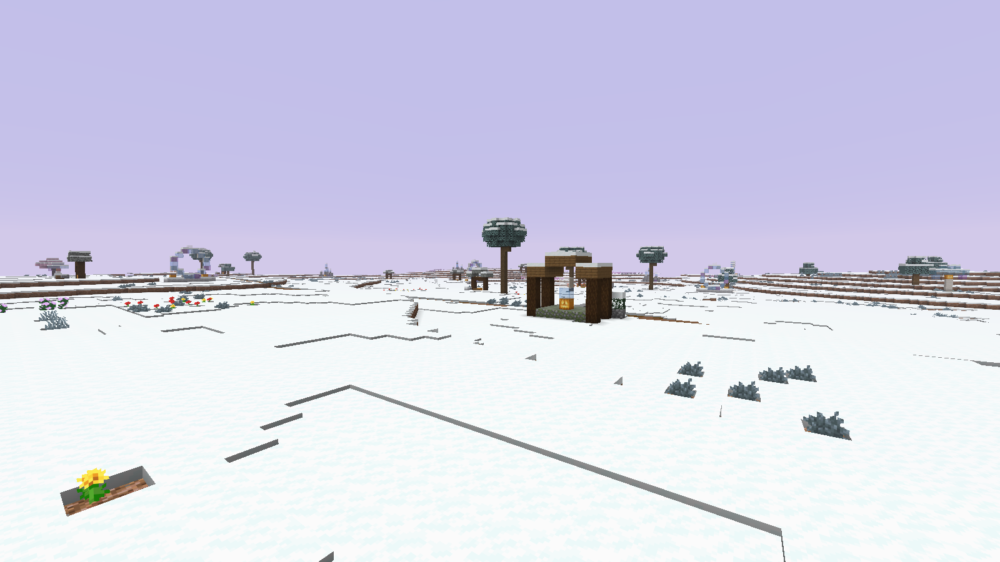
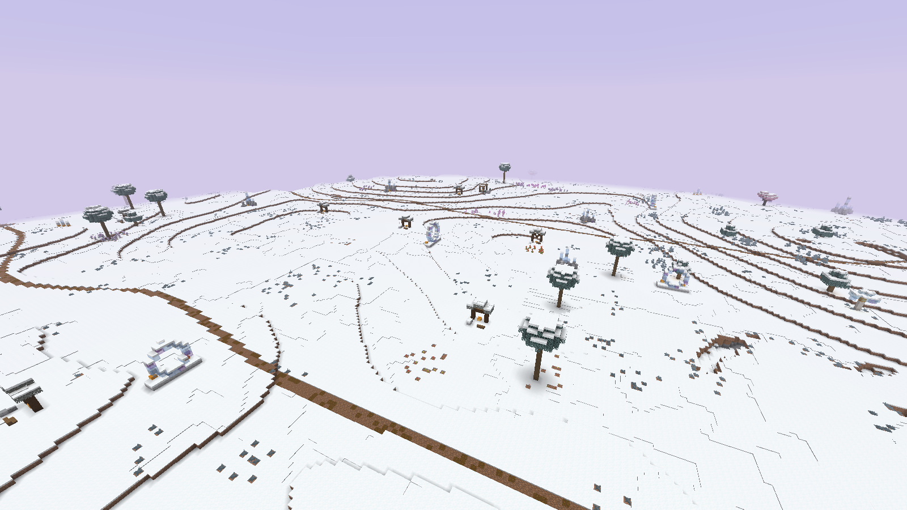
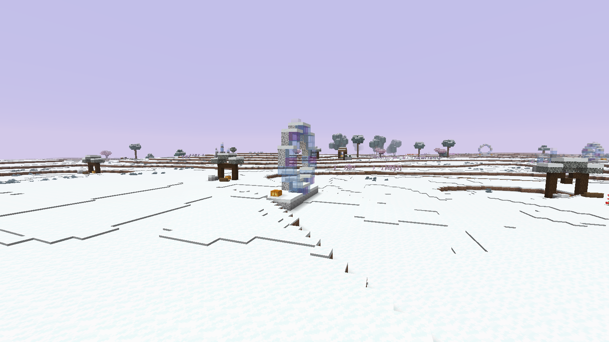
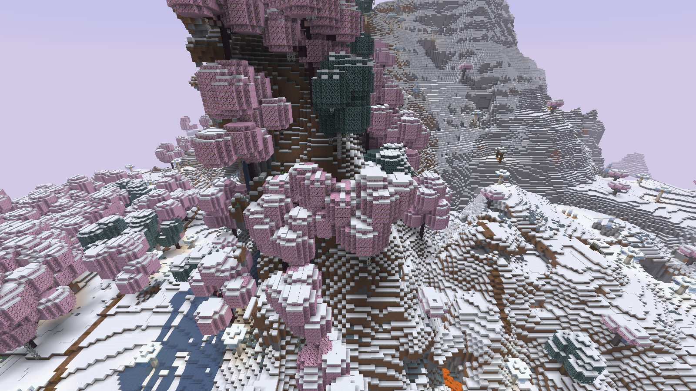

# Реальные кадры0.7.0 — пологие луга и сказочные горы

Minecraft1.21.11, seed825180311. Четыре оригинальных F2 PNG1600×900. Без обработки, ручного выравнивания и размещения объектов для съёмки. Местность, деревья, тропы и постройки созданы генератором. Все камеры, UTC-время и SHA256 — [provenance.json](provenance.json).

Проверенный256×256 луг: X−1920..−1665, Z1920..2175. Основные80% высот Y80..85, полный диапазон Y73..93; свободный проход99,54%. На нём записаны четыре арки, два святилища, редкие деревья и другие детали. Полный скан учитывает пещерные выходы и крайние перепады. [Измерения](../meadow07-field-audit.json) · [Декор](../meadow07-field-decorations.json).

Луг с мягкими перепадами, цветами, редкими деревьями и святилищем.

Панорама пологих холмов: между укрытиями остаются широкие проходы.

Лунная арка в лугу, вид сбоку. Обычные разрушаемые материалы.

Высокие сказочные склоны и леса вне лугов сохраняются.

[Все4 PNG архивом](../../dist/game-screenshots-fantasy-0.7.0.zip) · [Ещё11 мест предыдущей версии0.6.0](../screenshots-variety06/README.md)
