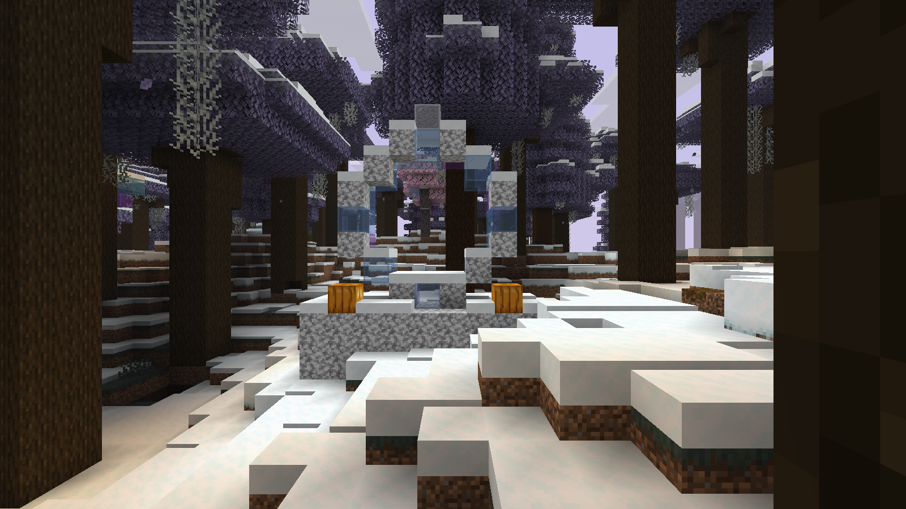
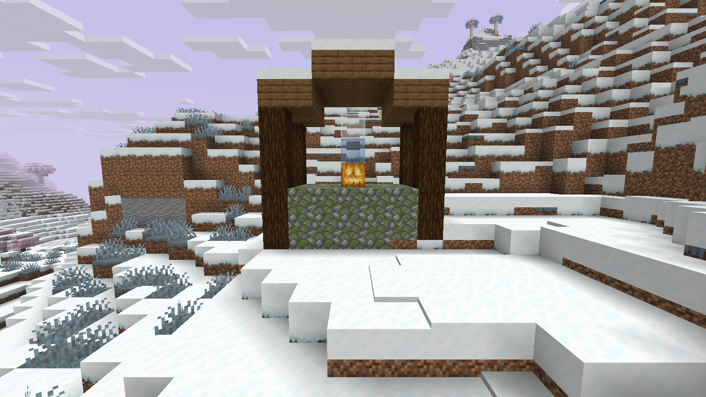
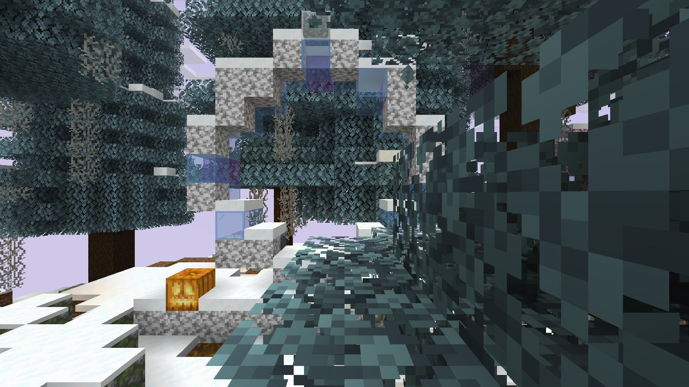

# Реальные кадры Anarchy Fantasy 0.5.0

Официальный Minecraft 1.21.11, native F2, 1600×900. Без шейдеров, resource pack, обработки и ручной постройки сцены. Seed 825180311, текущий JAR. Источники/камеры/время UTC/SHA — provenance.json.

[Кадр F3](08-f3-proof.png) подтверждает версию клиента; он не предназначен для оценки композиции. Неудачные ракурсы и кадр до загрузки чанков сохранены отдельно в history/capture-attempts-anarchy05, не включены в выбранную галерею.

Показаны естественно размещённые арки и святилище. Это выборочные кадры, не визуальная проверка всех биомов, руин и краёв крон. Материалы новых объектов обычные, постройки разрушаемые.
