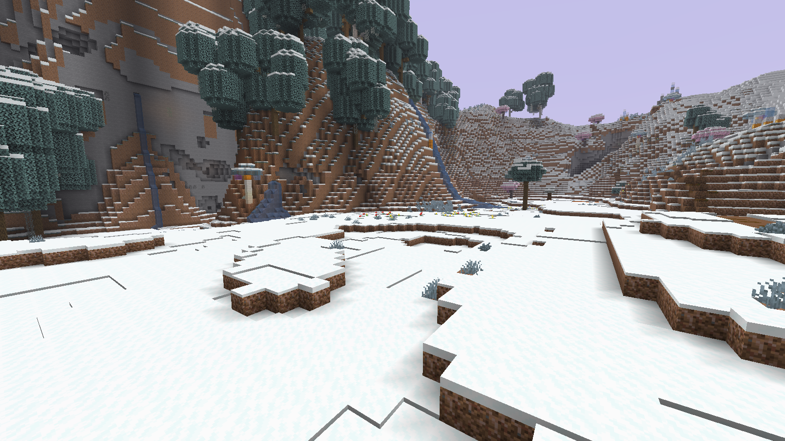
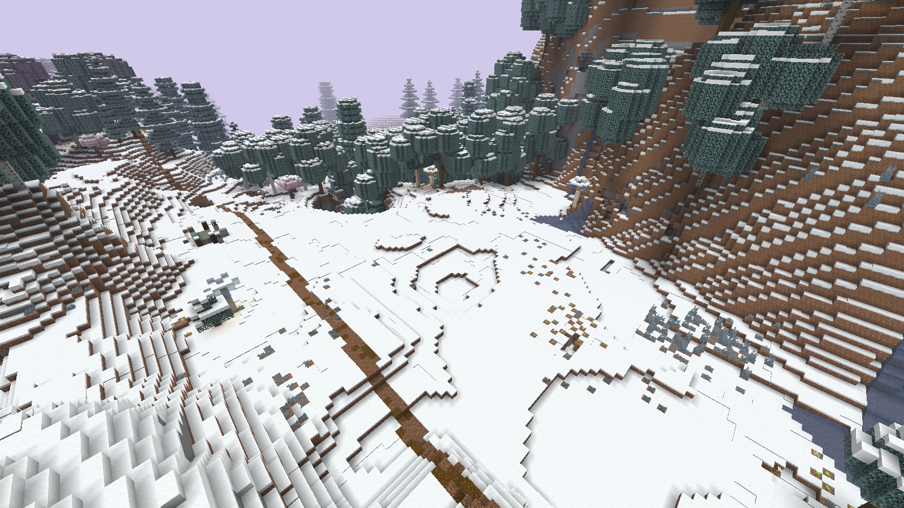
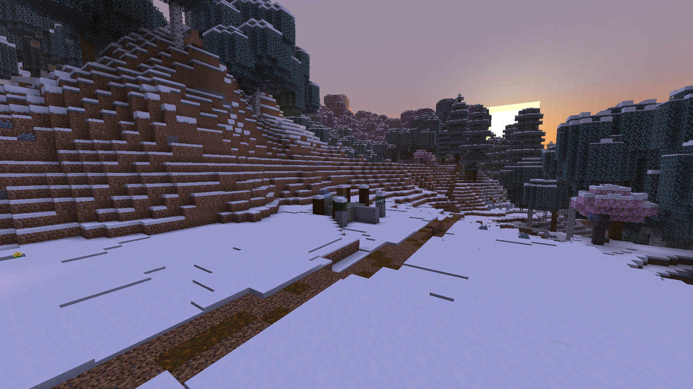
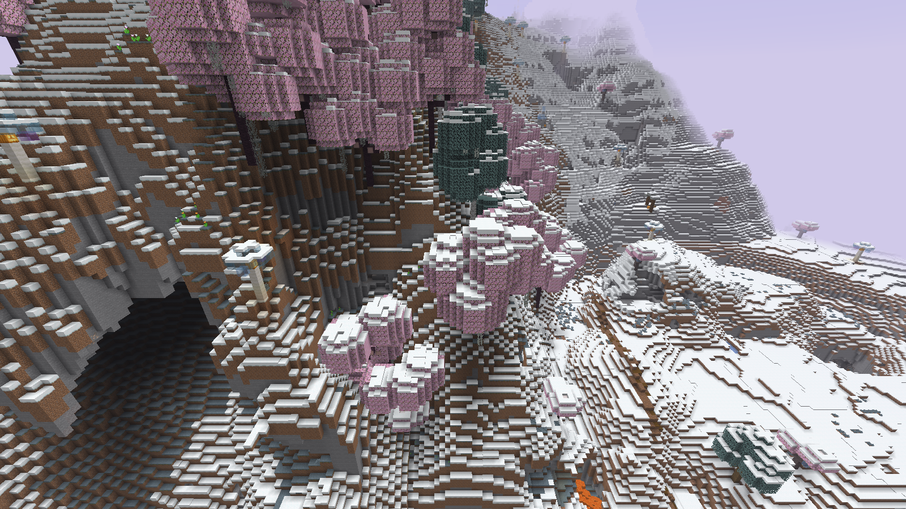

# Реальные кадры0.7.0 — естественная поляна64×64

Minecraft1.21.11, seed825180311. Оригинальные F2 PNG1600×900. Без обработки, выравнивания или расстановки объектов для съёмки. Грунт, лес, тропа и руина сгенерированы игрой и плагином. [Камеры, хеши и время](provenance.json).

Проверенный квадрат: X224..287, Z264..327. Все4096 колонок измерены; основные80% высот — Y85..87. Открытый headroom —100%, высокие кроны/укрытия —1,51%. Полный диапазон Y76..93 включает редкие неровности и пещерные выходы; детали сохранены в [скане](../meadow64n-field-audit.json). Рядом, вне64×64 ядра, находится деревянная руина202,85,329. [Декор и расположение относительно квадрата](../meadow64n-field-decorations.json).

Поляна с мягким естественным рельефом, травой и цветами.

Вид сверху: открытое место64×64 вписано в лес и сказочные склоны.

Деревянная руина рядом с поляной на закате; обычные разрушаемые материалы.

Крупные сказочные горы и леса вне полян сохранены.

[Скачать все4 PNG](../../dist/game-screenshots-fantasy-0.7.0.zip) · [Ещё11 разных мест версии0.6.0](../screenshots-variety06/README.md)
