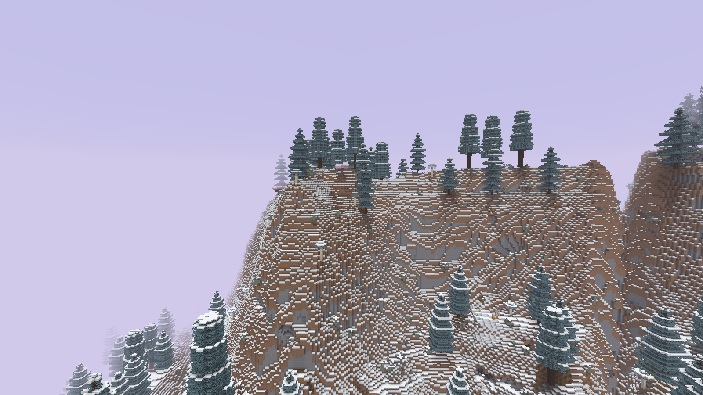
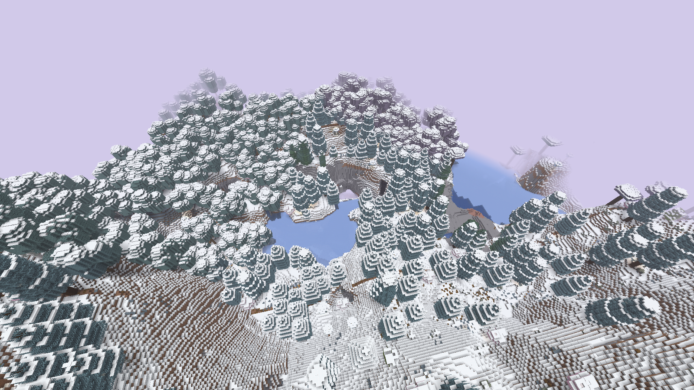
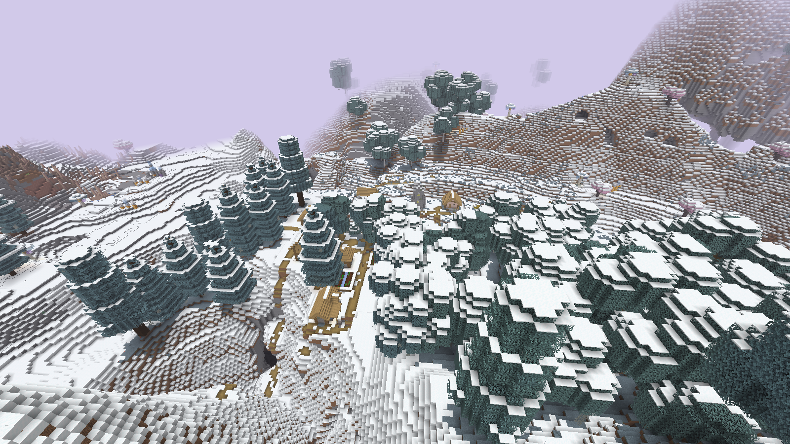
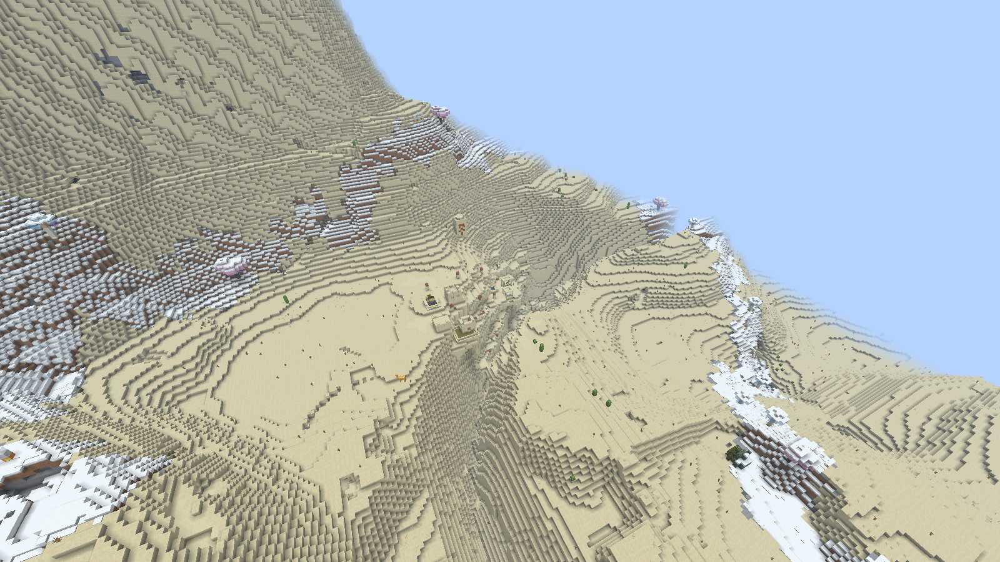

# Реальный рельеф 0.6.0

Официальный Minecraft 1.21.11, native F2, 1600×900. Без шейдеров, resource pack, обработки и ручной постройки сцен. Seed 825180311, текущий JAR и включённый native terrain. Исходники/камеры/время UTC/SHA — provenance.json.

[Native F3](03-terrain-f3.png) подтверждает клиент, seed и камеру. FPS программного llvmpipe не равен server TPS. Выбранные снимки сделаны после загрузки окружения; два ранних недогруженных кадра сохранены в history/capture-attempts-terrain06 и не входят в галерею.

Показаны выборочные гряды/долины и две деревни, не визуальная приёмка всех структур и биомов. В пустыне нет зимнего override; снег на соседних холодных участках показывает границы биомов. Конфиги руд/пещер/структур не заменялись; точные raw block states и рудные позиции со старой картой местами различаются.
