# Ещё 11 реальных кадров — версия 0.6.0

Та же опубликованная сборка 0.6.0, seed 825180311. Оригинальные Minecraft F2 PNG 1600×900: без обработки, шейдеров и resource pack. Местность и постройки для кадров вручную не создавались. В lush-пещере применено обычное игровое ночное зрение. Камеры/время/хеши — provenance.json.

Видны и границы биомов: соседние холодные полосы могут пересекать тёплые районы. На месте поиска frozen_peaks новый рельеф открыл участок dripstone_caves; подпись описывает фактически видимый разлом. Это дополнительные виды 0.6, не новая версия плагина.

1. **Зимняя роща с розовыми ивами**

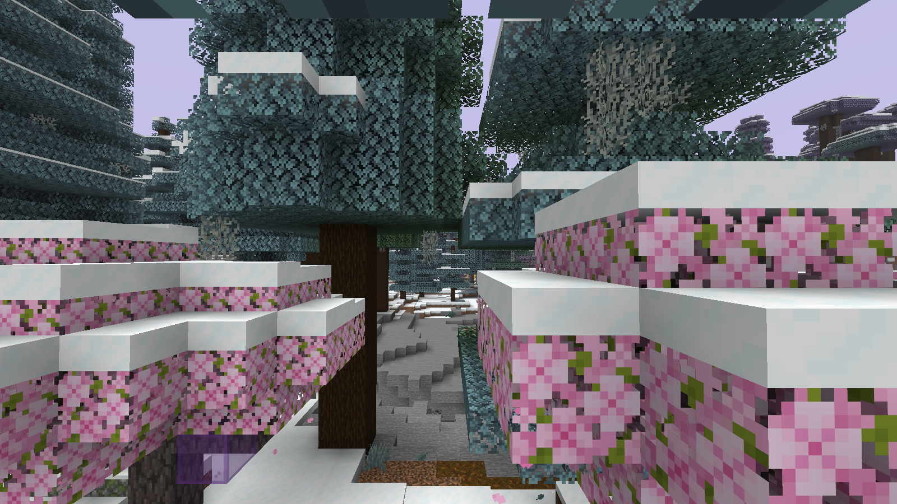

2. **Цветочный лес на склонах**

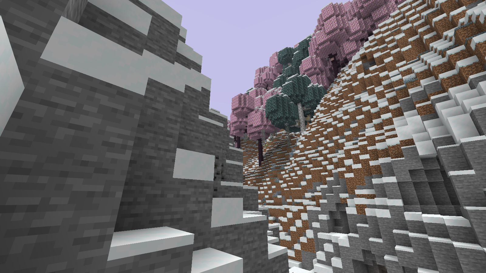

3. **Снежная тайга и замёрзшая вода**

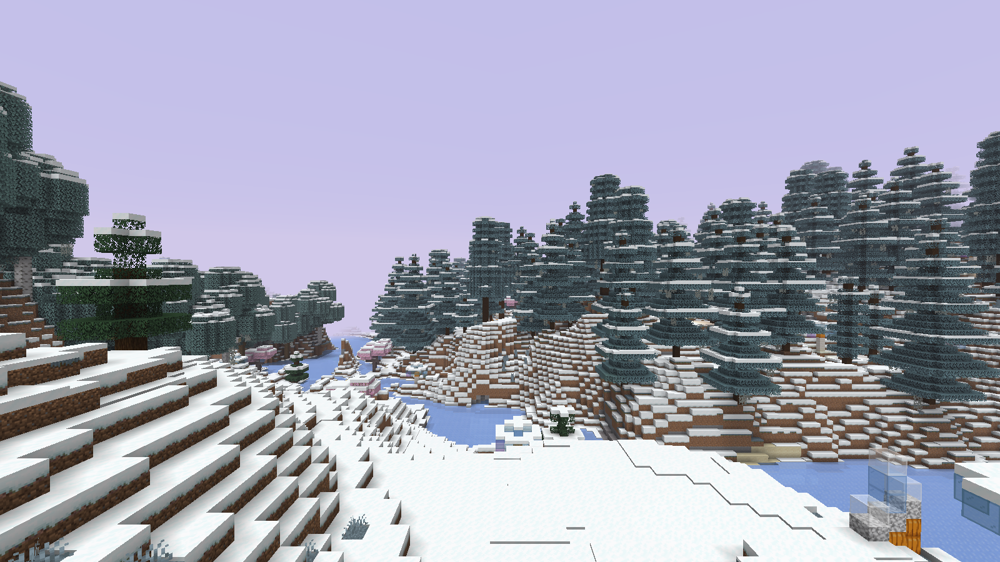

4. **Ледяные скалы и открытый каменный разлом**

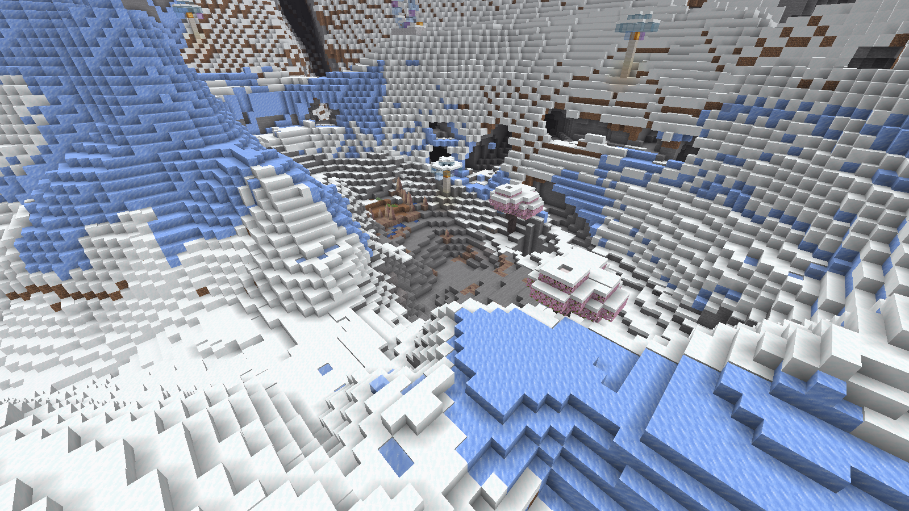

5. **Ущелье в речном биоме**

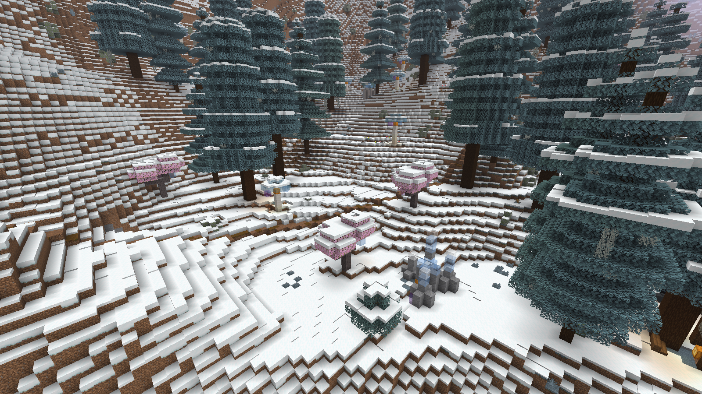

6. **Побережье и море**

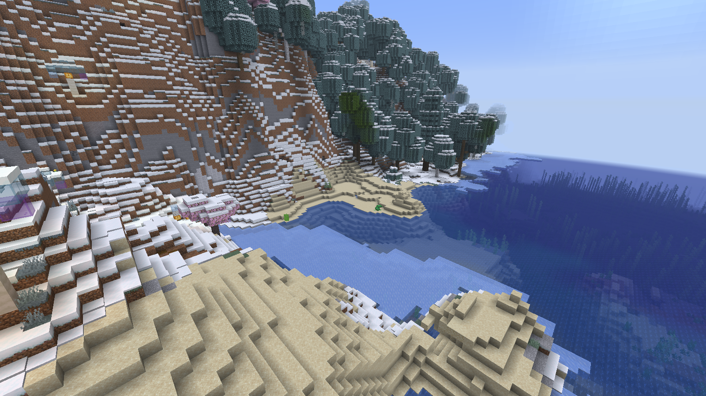

7. **Красные каньоны у границы биомов**

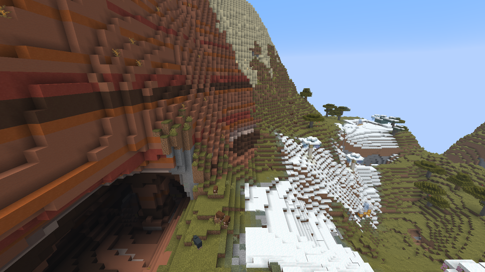

8. **Саванна и горные склоны**

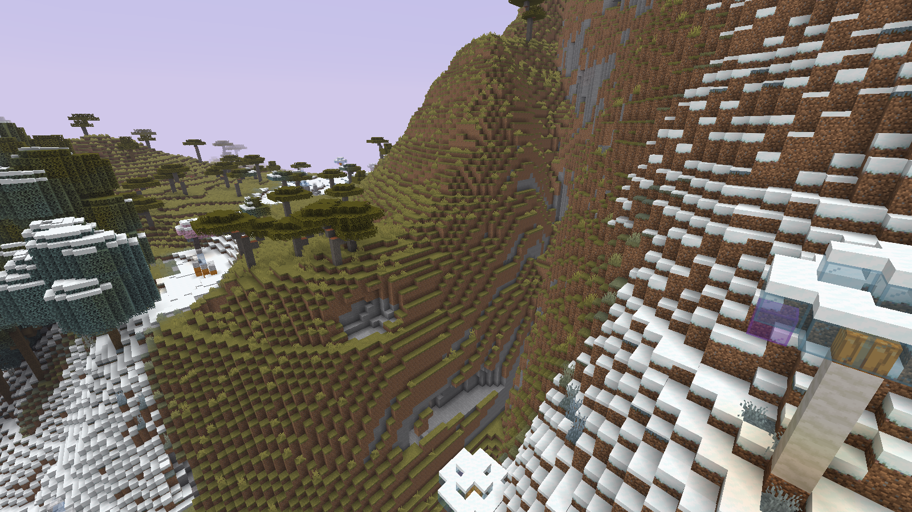

9. **Зелёные джунгли на высоте**

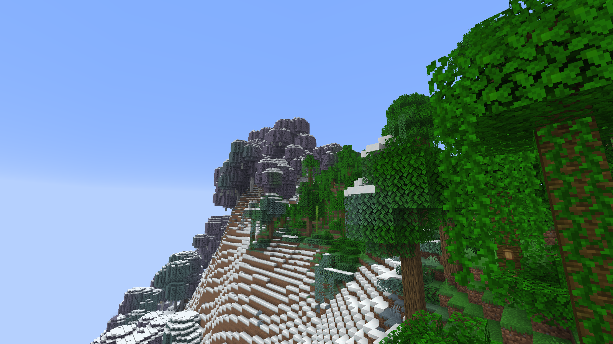

10. **Панорама розовых крон**

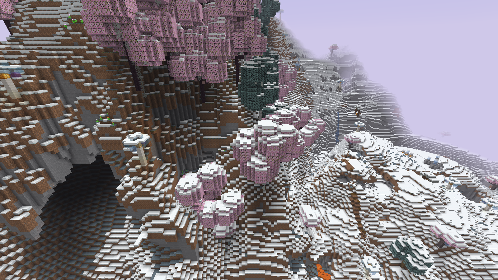

11. **Lush-пещера с ночным зрением**

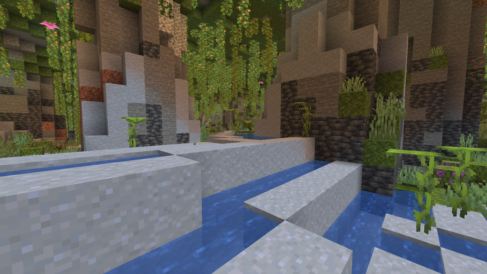

